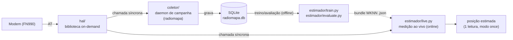

# Código do TCC — HAL, Coletor e Estimador de Posição

Implementação em Python das 3 camadas definidas em `planejamento/arquitetura_hal.md`,
`planejamento/arquitetura_coleta_dados.md` e `planejamento/arquitetura_estimadores_posicao.md`.
Este README foca em **como instalar e rodar numa Raspberry Pi** e em como os 3 componentes se
encaixam. **Cada componente tem seu próprio README, mais detalhado**, explicando o que ele faz
sozinho e qual tipo de geolocalização ele serve:

- [`hal/README.md`](hal/README.md) — a biblioteca que fala com o modem.
- [`coletor/README.md`](coletor/README.md) — o daemon que constrói o radiomapa (treino do WKNN e avaliação).
- [`estimador/README.md`](estimador/README.md) — Cell-ID e fingerprinting WKNN: treino offline, avaliação e medição ao vivo.
- [`deprecated/README.md`](deprecated/README.md) — scripts antigos guardados só como histórico (não rodam).

```
codigo/
    hal/              # biblioteca on-demand (fala com o modem, sob demanda -- não é daemon)
        health.py             # monitor de saúde da conexão -- usado pelo Coletor
    acquisition/      # aquisição compartilhada: 1 snapshot (MONI, SERVINFO, CSURV, GNSS) com status e motivos
    coletor/          # o daemon de campanha de campo (grava snapshots no SQLite)
    estimador/        # Cell-ID + WKNN: OFFLINE (train.py, evaluate.py) e ONLINE (live.py); detalhes no README dele
        network_registry.example.json  # modelo do cadastro de células (por global_cell_key) -- copie e preencha
        live.py                # ONLINE -- 1 leitura do modem -> 1 estimativa (wknn ou cell-id), sem depender do Coletor
        db.py                   # formato do banco position_estimates do live.py antigo (só leitura, evaluate live)
        methods/
            cell_id.py            # Cell-ID por global_cell_key + validação do cadastro (baseline)
            fingerprint.py        # Fingerprinting WKNN (Python puro, bundle JSON) -- único com treino
    experimental/     # TA, sonda LPP e geometria de bearings; fora do caminho principal, não validados
    deprecated/       # histórico (compare/infer/relatorio antigos); nada ativo importa daqui
    requirements.txt      # runtime do alvo: só pyserial (HAL, aquisição, Coletor, Estimador)
    requirements-dev.txt  # PC de desenvolvimento: pytest
    tests/                # pytest; fixtures AT rotuladas em tests/fixtures/at/
    README.md         # este arquivo
```

### Como os 3 componentes conversam entre si



O HAL não sabe que o Coletor ou o `live.py` existem (só responde quando chamado). O Coletor
só grava o que o HAL devolve; o radiomapa alimenta o treino do WKNN e a avaliação do Cell-ID.
`live.py` fala com o HAL **diretamente**, sem depender do Coletor estar rodando, para
responder "onde estou agora".

### Métodos de posição

| Método | Situação | Precisa do radiomapa? | Como usar |
|---|---|---|---|
| Cell-ID (`global_cell_key` → posição cadastrada da célula) | principal (baseline) | Para avaliar, sim | `estimador.live cell-id`; `estimador.evaluate cell-id`/`compare` |
| Fingerprinting WKNN | principal | **Sim** | `estimador.train` (offline), `estimador.evaluate compare`, `estimador.live wknn` |
| Cell-ID + Timing Advance | experimental (`experimental/timing_advance.py`) | Não | sem TA real: `unavailable`; o firmware atual não expõe TA (ver `hal/README.md`) |
| Geometria de bearings (DL-AoD/UL-AoA) | experimental (`experimental/angular_geometry.py`) | Não | só com ângulos externos; nenhum ângulo real foi obtido |

---

## 1. Requisitos

- Raspberry Pi 3 ou 4 com Raspberry Pi OS (Debian) — ou uma imagem Buildroot própria (ver nota no fim desta seção).
- Python 3.9 ou mais novo (`python3 --version`).
- Modem Telit FN990 (ou compatível) conectado via o adaptador M.2 → USB.
- Acesso root/sudo, ao menos na primeira configuração.

**Nota Buildroot:** se você estiver usando a imagem Buildroot customizada do projeto (em vez do
Raspberry Pi OS), instale `python3-pyserial` como pacote do `menuconfig` em vez de usar `pip`
(é a única dependência de runtime). Se
`python3-pyserial` não estiver disponível, existe um plano B sem `pyserial` descrito em
`planejamento/arquitetura_hal.md`, Seção 1.

---

## 2. Instalação na Raspberry Pi (Raspberry Pi OS)

```bash
# 1. Atualizar o sistema e instalar Python/venv
sudo apt update
sudo apt install -y python3 python3-venv python3-pip

# 2. Copiar esta pasta `codigo/` inteira para a Raspberry Pi
#    (scp, git clone, pendrive -- qualquer forma de trazer os arquivos para lá)
scp -r codigo/ pi@<ip-da-raspberry>:/home/pi/tcc-codigo

# 3. Entrar na pasta e criar um ambiente virtual
cd /home/pi/tcc-codigo
python3 -m venv venv
source venv/bin/activate

# 4. Instalar as dependências Python
#    requirements.txt (só pyserial) basta para HAL, aquisição, Coletor e o Estimador ativo
#    (train/live são Python puro). requirements-dev.txt é só para o PC (pytest e scripts legados).
pip install -r requirements.txt

# 5. Dar permissão de acesso à porta serial do modem (evita precisar rodar tudo como root)
sudo usermod -aG dialout $USER
# faça logout e login de novo (ou reinicie) para o grupo valer

# 6. Conectar o modem via USB e descobrir qual /dev/ttyUSBx é a porta de comandos AT
dmesg | tail -30
ls /dev/ttyUSB*
# teste cada porta até uma responder "Vivo":
python -m hal.cli --port /dev/ttyUSB0 alive
python -m hal.cli --port /dev/ttyUSB2 alive
```

**Todos os comandos abaixo assumem que você está com o `venv` ativado e dentro da pasta
`codigo/`** (é isso que faz `python -m hal.cli`, `python -m coletor.daemon` etc. funcionarem
sem precisar instalar nada como pacote).

---

## 3. HAL — testar o modem sozinho (sem o Coletor rodando)

Útil para descobrir a porta certa, confirmar que o modem responde, ou depurar um comando
específico em campo, sem precisar subir o daemon inteiro. **Ver [`hal/README.md`](hal/README.md)
para a explicação completa (o que cada método faz/não faz e para qual geolocalização serve).**

```bash
python -m hal.cli --port /dev/ttyUSB2 alive       # "Vivo" ou "Sem resposta"
python -m hal.cli --port /dev/ttyUSB2 status      # fabricante, modelo, firmware, IMEI, SIM, uptime, temperatura...
python -m hal.cli --port /dev/ttyUSB2 prepare     # liga o GNSS só se AT$GPSP? disser que está desligado
python -m hal.cli --port /dev/ttyUSB2 moni        # célula servidora LTE/NR e modo de acesso (AT#MONI)
python -m hal.cli --port /dev/ttyUSB2 servinfo    # PLMN da servidora (AT#SERVINFO)
python -m hal.cli --port /dev/ttyUSB2 csurv       # varredura de células com radio_key/global_cell_key (AT#CSURV, até 3 min)
python -m hal.cli --port /dev/ttyUSB2 gnss        # AT$GPSACP: fix 2D/3D, HDOP, satélites, UTC
python -m hal.cli --port /dev/ttyUSB2 reboot      # ALTERA ESTADO: reinicia o módulo (AT#REBOOT)
```

Cada comando imprime a leitura em JSON com `status` e a resposta crua. Os formatos foram
conferidos no manual do FN990 (Rev.5) e em fragmentos de campo, e os parsers têm testes com
fixtures rotuladas (`tests/fixtures/at/`). Uma resposta fora do formato esperado vira
`status: malformed`, sem exceção; nesse caso, guarde a resposta crua e acrescente uma fixture.

Para ver um ciclo completo, como o Coletor e o `live.py` leem o modem:

```bash
python -m acquisition.snapshot --port /dev/ttyUSB2               # prepare + 1 snapshot em JSON
```

O snapshot sai `complete`, `partial` ou `invalid`, com os motivos (`reasons`) e a latência de
cada comando (`timings_s`). Ele traz a servidora com `radio_key`/`global_cell_key` e todas as
observações de célula, cada uma com a fonte (`MONI`, `SERVINFO` ou `CSURV`).

Testes automatizados (no PC, com `pip install -r requirements-dev.txt`): `python -m pytest`.

---

## 4. Coletor — grava sessões de coleta no banco v2

O Coletor grava cada snapshot da aquisição compartilhada num SQLite com schema v2: sessões,
pontos de referência, medições (inclusive as inválidas, com os motivos), células observadas e
health checks. **Ver [`coletor/README.md`](coletor/README.md) para a explicação completa.**

```bash
# Status do modem (não grava nada)
python -m coletor.daemon status --port /dev/ttyUSB2

# Cadastrar a coordenada de um ponto de referência
python -m coletor.daemon point-add --db radiomapa_v2.db P01 --lat -26.90012 --lon -49.07034 --coord-source levantamento

# 1 snapshot numa sessão nova, parado no ponto P01
python -m coletor.daemon once --port /dev/ttyUSB2 --db radiomapa_v2.db \
    --scenario estatico --environment outdoor --reference-point P01 --campaign-plmn 72406

# Contínuo: 1 snapshot a cada --interval segundos (grade monotônica), até o limite ou Ctrl+C
python -m coletor.daemon continuous --port /dev/ttyUSB2 --db radiomapa_v2.db --interval 60 \
    --scenario pedestre --environment outdoor --route trilha_1 --campaign-plmn 72406
```

- `--scenario`: `estatico` | `pedestre` | `veicular`
- `--environment`: `indoor` | `outdoor`
- `--reference-point NOME` ou `--route NOME`: um dos dois é obrigatório
- `--db`: arquivo SQLite v2, criado se não existir. Na Raspberry Pi, use uma partição de dados
  (ex.: `/data/radiomapa_v2.db`). Um banco v1 é recusado sem alteração; veja a migração abaixo.

No modo contínuo, o Coletor registra saúde no início e no fim, em transições (falha ou
recuperação) e periodicamente. Depois de 3 ciclos seguidos sem resposta, ele tenta reconectar.
`Ctrl+C` ou `SIGTERM` encerram depois do ciclo em andamento, e a sessão fica `interrupted`.
Uma exceção deixa a sessão `error`, com o motivo registrado.

### Backup completo em CSV e restauração

```bash
python -m coletor.export_csv export --db radiomapa_v2.db --out backups/2026-09-30
python -m coletor.export_csv restore --from backups/2026-09-30 --db restaurado_v2.db
```

Rode o export ao fim de cada sessão de campo. Ele cria um CSV por tabela e um `metadata.json`
com SHA-256 e contagens, e a restauração reconstrói o banco inteiro. É o backup que sobrevive
mesmo se o cartão SD corromper.

### Bancos v1 antigos: inspeção e migração não destrutiva

```bash
python -m coletor.migrate inspect --db radiomapa.db
python -m coletor.migrate migrate --db radiomapa.db --out radiomapa_v2.db
```

A origem só é lida (SHA-256 conferido antes e depois), e a saída precisa ser um arquivo novo.
As linhas migradas ficam marcadas como `legacy_ambiguous`, sem `radio_key`/`global_cell_key`,
porque o v1 não guardava ARFCN, PLMN nem o modo de acesso medido.

### (Opcional) Rodar como serviço `systemd`

Só vale a pena se quiser que o Coletor suba sozinho no boot e se autorrecupere de quedas —
não é necessário para uma campanha de coleta supervisionada manualmente. Exemplo:

```ini
# /etc/systemd/system/coletor-tcc.service
[Unit]
Description=Coletor de dados celulares do TCC
After=network.target

[Service]
WorkingDirectory=/home/pi/tcc-codigo
ExecStart=/home/pi/tcc-codigo/venv/bin/python -m coletor.daemon continuous --interval 60 \
    --scenario pedestre --environment outdoor --route trilha_1 --campaign-plmn 72406 \
    --port /dev/ttyUSB2 --db /data/radiomapa_v2.db
Restart=on-failure

[Install]
WantedBy=multi-user.target
```

```bash
sudo systemctl daemon-reload
sudo systemctl enable --now coletor-tcc.service
journalctl -u coletor-tcc.service -f   # acompanhar o log em tempo real
```

---

## 5. Estimador — Cell-ID e WKNN: treino offline, avaliação e medição ao vivo

O Cell-ID devolve a posição cadastrada da célula servidora (busca pela `global_cell_key` em
`estimador/network_registry.json`; copie o `.example.json`). O WKNN usa o RSRP das células do
`#CSURV` e é treinado com o radiomapa v2. Protocolos, bundle e cadastro: **ver
[`estimador/README.md`](estimador/README.md).**

```bash
# treino (spatial = grupo por ponto de referência; temporal = grupo por sessão)
python -m estimador.train --db radiomapa_v2.db --technology LTE --protocol spatial --out modelos/wknn_lte_spatial.json
python -m estimador.train --db radiomapa_v2.db --technology LTE --protocol temporal --out modelos/wknn_lte_temporal.json

# WKNN e Cell-ID nas mesmas amostras de teste do bundle; validação do cadastro
python -m estimador.evaluate compare --db radiomapa_v2.db --model modelos/wknn_lte_spatial.json \
    --registry estimador/network_registry.json --out resumo_spatial.csv
python -m estimador.evaluate cell-id --db radiomapa_v2.db --registry estimador/network_registry.json

# estimar a posição agora com 1 leitura do FN990, sem depender do Coletor (--json: resultado completo)
python -m estimador.live wknn --port /dev/ttyUSB2 --model modelos/wknn_lte_spatial.json
python -m estimador.live cell-id --port /dev/ttyUSB2 --registry estimador/network_registry.json
```

O treino do WKNN exige grupos suficientes no protocolo escolhido (pelo menos 3 pontos de
referência ou 3 sessões com referência posicional) e encerra com
`spatial_validation_unavailable`/`temporal_validation_unavailable: insufficient_groups` quando
faltam; não há divisão aleatória por linha.

---

## 6. Solução de problemas comuns

| Sintoma | Causa provável | O que fazer |
|---|---|---|
| `PermissionError` ao abrir `/dev/ttyUSBx` | Usuário não está no grupo `dialout` | `sudo usermod -aG dialout $USER` e fazer logout/login |
| `ConnectionError: ... não respondeu OK a 'AT'` | Porta errada ou modem desligado | Confirme a porta com `ls /dev/ttyUSB*` e `python -m hal.cli --port ... alive` |
| `erro: ... banco do Coletor no formato v1` | O `--db` aponta para um banco antigo | Use `python -m coletor.migrate inspect/migrate` para gerar uma cópia v2, ou um arquivo novo |
| `erro: schema_v1: ...` ao rodar `estimador.train`/`evaluate` | O Estimador lê só o schema v2 | Gere uma cópia v2 com `python -m coletor.migrate migrate` (as linhas migradas ambíguas ficam fora) |
| `erro: test_samples_missing`/`test_samples_changed` no `evaluate compare` | O banco não é o do treino ou mudou depois dele (inclusive novas sessões num ponto sem coordenada cadastrada) | Use o mesmo radiomapa do treino, ou treine de novo |
| Resposta vem sempre `ERROR` ou vazia | Porta serial errada (não é a porta AT) | Teste outras portas `ttyUSBx` até achar a que responde `OK` a `AT` |
| `sqlite3.OperationalError: database is locked` | Duas instâncias do Coletor abertas ao mesmo tempo sobre o mesmo `.db` | Rode só 1 instância do Coletor por banco |
| `estimador.evaluate`/`live` dá erro de subcomando | Esqueceu o subcomando logo após o nome do módulo | Ex.: `python -m estimador.evaluate compare --db ...` (subcomando vem antes das flags) |
| `insufficient_groups` ao treinar | Poucos pontos de referência (spatial) ou sessões (temporal) com referência posicional | Colete mais pontos/sessões antes de treinar o WKNN |
| `invalid_registry` ao usar `cell-id` | Cadastro ausente, no formato antigo (chave por PCI) ou com campo inválido | Copie `estimador/network_registry.example.json` e preencha por `global_cell_key`; a mensagem indica a entrada e o campo |
| `estimador.live` termina com `snapshot inválido` ou `unavailable` | A leitura não trouxe células (ou, no WKNN, nenhuma `radio_key` do bundle) | Veja os motivos impressos; rode `python -m acquisition.snapshot --port ...` para ver a leitura completa |
| `Sem fix GNSS ainda` | GNSS ainda não conseguiu um *fix* (TTFF) | Aguarde alguns minutos em ambiente aberto (ver `planejamento/guia_comandos_modem.md`, Seção 8) |

---

---

## 7. Para entender cada componente em detalhe

- [`hal/README.md`](hal/README.md) / [`coletor/README.md`](coletor/README.md) / [`estimador/README.md`](estimador/README.md) — o que cada componente faz, sozinho, e para qual geolocalização serve.
- [`planejamento/arquitetura_hal.md`](../planejamento/arquitetura_hal.md) — por que o HAL é uma biblioteca on-demand, não um daemon.
- [`planejamento/arquitetura_coleta_dados.md`](../planejamento/arquitetura_coleta_dados.md) — concorrência, schema do banco, ciclo de vida de sessão.
- [`planejamento/arquitetura_estimadores_posicao.md`](../planejamento/arquitetura_estimadores_posicao.md) — vocabulário de features, treino, métricas.
- [`planejamento/knn_explicado.md`](../planejamento/knn_explicado.md) — conceitos de KNN/WKNN do zero.
- [`planejamento/guia_comandos_modem.md`](../planejamento/guia_comandos_modem.md) — comandos AT confirmados no FN990 real.
