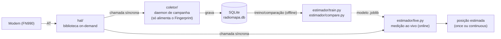

# Código do TCC — HAL, Coletor e Estimador de Posição

Implementação em Python das 3 camadas definidas em `planejamento/arquitetura_hal.md`,
`planejamento/arquitetura_coleta_dados.md` e `planejamento/arquitetura_estimadores_posicao.md`.
Este README foca em **como instalar e rodar numa Raspberry Pi** e em como os 3 componentes se
encaixam. **Cada componente tem seu próprio README, mais detalhado**, explicando o que ele faz
sozinho e qual tipo de geolocalização ele serve:

- [`hal/README.md`](hal/README.md) — a biblioteca que fala com o modem.
- [`coletor/README.md`](coletor/README.md) — o daemon que constrói o radiomapa (só para o Fingerprint treinar).
- [`estimador/README.md`](estimador/README.md) — os 5 métodos de estimativa de posição (treino offline + medição ao vivo).

```
codigo/
    hal/              # biblioteca on-demand (fala com o modem, sob demanda -- não é daemon)
        health.py             # monitor de saúde da conexão -- usado pelo Coletor E pelo estimador/live.py
    coletor/          # o daemon de campanha de campo (usa o HAL em loop, grava o radiomapa no SQLite)
    estimador/        # OFFLINE (train.py/compare.py) + ONLINE (live.py), 5 métodos em estimador/methods/
        network_registry.example.json  # cadastro de posição/azimute das células -- copie e preencha
        live.py                # ONLINE -- mede a posição agora, 1+ métodos ao mesmo tempo, sem depender do Coletor
        db.py                   # SQLite próprio (position_estimates) -- o que live.py salva
        relatorio.py            # compara os métodos usando o que live.py salvou
        methods/
            network_position.py  # Cell-ID/E-CID, E-CID de rede, Cell-ID+TA -- sem ML, cadastro conhecido
            fingerprint.py        # Fingerprinting completo (KNN/WKNN + Random Forest) -- Único com ML
            aoa.py                 # DL-AoD/UL-AoA (geometria pura, sem ML)
    requirements.txt
    README.md         # este arquivo
```

### Como os 3 componentes conversam entre si



O HAL não sabe que o Coletor ou o `live.py` existem (só responde quando chamado). O Coletor
só grava o que o HAL devolve -- hoje isso só alimenta o treino do Fingerprint. `live.py` fala
com o HAL **diretamente**, sem depender do Coletor estar rodando, para responder "onde estou
agora" com qualquer um dos 5 métodos.

### Resposta direta: "dá pra fazer todos os tipos de geolocalização que vou tentar, até AoA?"

**Sim.** E com controle total do core (você vai saber a posição real das células), 4 dos 5
métodos viraram cálculo direto -- só o Fingerprint ainda usa aprendizado de máquina:

| Método | Usa ML? | Precisa do Coletor/radiomapa? | Como medir agora |
|---|---|---|---|
| Cell-ID / E-CID | Não | Não | `estimador.live` ou `estimador.infer cell_id` |
| E-CID de rede | Não | Não | mesma função do Cell-ID -- só falta a integração com o core (ver `estimador/README.md`) |
| Cell-ID + Timing Advance | Não | Não | `estimador.live` ou `estimador.infer ta` -- **hoje se comporta igual ao Cell-ID puro**: o TA não é exposto pelo firmware atual do modem, só com upgrade (ver `hal/README.md`) |
| Fingerprinting | **Sim** | **Sim** -- único que precisa | `estimador.train` (offline) depois `estimador.live`/`infer fingerprint` |
| DL-AoD / UL-AoA | Não | Não | `estimador.live`/`infer aoa` -- mas o **ângulo** ainda precisa ser extraído manualmente do relatório LPP (ver `hal/README.md`) |

---

## 1. Requisitos

- Raspberry Pi 3 ou 4 com Raspberry Pi OS (Debian) — ou uma imagem Buildroot própria (ver nota no fim desta seção).
- Python 3.9 ou mais novo (`python3 --version`).
- Modem Telit FN990 (ou compatível) conectado via o adaptador M.2 → USB.
- Acesso root/sudo, ao menos na primeira configuração.

**Nota Buildroot:** se você estiver usando a imagem Buildroot customizada do projeto (em vez do
Raspberry Pi OS), instale as dependências como pacotes do `menuconfig` (`python3-pyserial`,
`python3-pandas`, `python3-numpy`, `python3-scikit-learn`) em vez de usar `pip`. Se
`python3-pyserial` não estiver disponível, existe um plano B sem `pyserial` descrito em
`planejamento/arquitetura_hal.md`, Seção 1.

---

## 2. Instalação na Raspberry Pi (Raspberry Pi OS)

```bash
# 1. Atualizar o sistema e instalar Python/venv
sudo apt update
sudo apt install -y python3 python3-venv python3-pip

# 2. Copiar esta pasta `codigo/` inteira para a Raspberry Pi
#    (scp, git clone, pendrive -- qualquer forma de trazer os arquivos para lá)
scp -r codigo/ pi@<ip-da-raspberry>:/home/pi/tcc-codigo

# 3. Entrar na pasta e criar um ambiente virtual
cd /home/pi/tcc-codigo
python3 -m venv venv
source venv/bin/activate

# 4. Instalar as dependências Python
pip install -r requirements.txt

# 5. Dar permissão de acesso à porta serial do modem (evita precisar rodar tudo como root)
sudo usermod -aG dialout $USER
# faça logout e login de novo (ou reinicie) para o grupo valer

# 6. Conectar o modem via USB e descobrir qual /dev/ttyUSBx é a porta de comandos AT
dmesg | tail -30
ls /dev/ttyUSB*
# teste cada porta até uma responder "Vivo":
python -m hal.cli --port /dev/ttyUSB0 alive
python -m hal.cli --port /dev/ttyUSB2 alive
```

**Todos os comandos abaixo assumem que você está com o `venv` ativado e dentro da pasta
`codigo/`** (é isso que faz `python -m hal.cli`, `python -m coletor.daemon` etc. funcionarem
sem precisar instalar nada como pacote).

---

## 3. HAL — testar o modem sozinho (sem o Coletor rodando)

Útil para descobrir a porta certa, confirmar que o modem responde, ou depurar um comando
específico em campo, sem precisar subir o daemon inteiro. **Ver [`hal/README.md`](hal/README.md)
para a explicação completa (o que cada método faz/não faz e para qual geolocalização serve).**

```bash
python -m hal.cli --port /dev/ttyUSB2 alive       # "Vivo" ou "Sem resposta"
python -m hal.cli --port /dev/ttyUSB2 status      # fabricante, modelo, firmware, IMEI, SIM, uptime, temperatura...
python -m hal.cli --port /dev/ttyUSB2 prepare     # liga o GNSS só se AT$GPSP? disser que está desligado
python -m hal.cli --port /dev/ttyUSB2 moni        # célula servidora LTE/NR e modo de acesso (AT#MONI)
python -m hal.cli --port /dev/ttyUSB2 servinfo    # PLMN da servidora (AT#SERVINFO)
python -m hal.cli --port /dev/ttyUSB2 csurv       # varredura de células com radio_key/global_cell_key (AT#CSURV, até 3 min)
python -m hal.cli --port /dev/ttyUSB2 gnss        # AT$GPSACP: fix 2D/3D, HDOP, satélites, UTC
python -m hal.cli --port /dev/ttyUSB2 lpp-config  # sonda experimental somente leitura (AT$LCSLPP?)
python -m hal.cli --port /dev/ttyUSB2 reboot      # reinicia o módulo (AT#REBOOT)
```

Cada comando imprime a leitura em JSON com `status` e a resposta crua. Os formatos foram
conferidos no manual do FN990 (Rev.5) e em fragmentos de campo, e os parsers têm testes com
fixtures rotuladas (`tests/fixtures/at/`). Uma resposta fora do formato esperado vira
`status: malformed`, sem exceção; nesse caso, guarde a resposta crua e acrescente uma fixture.

---

## 4. Coletor — constrói o radiomapa (só necessário para o Fingerprint)

O Coletor é o único componente que **é** um daemon de campanha de campo (o HAL não é — ver
`planejamento/arquitetura_hal.md`). Ele tem 3 modos. **Só é necessário se você for treinar o
Fingerprint** -- os outros 4 métodos não precisam de campanha de campo nenhuma. **Ver
[`coletor/README.md`](coletor/README.md) para a explicação completa.**

```bash
# Ver só o status do modem (não cria sessão de coleta)
python -m coletor.daemon --mode status --fn990-port /dev/ttyUSB2

# Modo sob demanda (padrão): 1 leitura de cada modem configurado, grava, e termina
python -m coletor.daemon --scenario pedestre --environment outdoor \
    --fn990-port /dev/ttyUSB2 --db radiomapa.db

# Modo contínuo: fica rodando, lendo a cada --interval segundos (padrão 60s = 1 min), até Ctrl+C
python -m coletor.daemon --mode continuous --interval 60 \
    --scenario pedestre --environment outdoor \
    --fn990-port /dev/ttyUSB2 --db radiomapa.db

# Qualquer um dos modos acima aceita --lpp-probe para também guardar a resposta crua de
# AT$LCSLPP? (sonda experimental, só leitura; nada é gravado no modem) em lpp_raw_log
python -m coletor.daemon --mode continuous --lpp-probe \
    --scenario pedestre --environment outdoor \
    --fn990-port /dev/ttyUSB2 --db radiomapa.db
```

- `--scenario`: `estatico` | `pedestre` | `veicular`
- `--environment`: `indoor` | `outdoor`
- `--db`: caminho do arquivo SQLite (na Raspberry Pi de verdade, use algo como
  `/data/radiomapa.db`, numa partição separada do sistema — ver
  `planejamento/arquitetura_coleta_dados.md`, Seção 3)

No modo contínuo, cada modem tem sua própria *thread* de leitura com **health check embutido**:
antes de cada leitura, o Coletor testa se o modem ainda responde (`AT` → `OK`); se falhar 3
vezes seguidas, ele tenta reconectar a porta serial sozinho. Os resultados de todo health check
(vivo ou não) ficam gravados na tabela `health_checks`, junto com as medições.

Para encerrar o modo contínuo, aperte `Ctrl+C` — o Coletor termina as *threads*, fecha o banco
e marca o fim da sessão (`sessions.ended_at`) antes de sair.

### Backup em CSV

```bash
python -m coletor.export_csv --db radiomapa.db --session 1 --out sessao_1.csv
python -m coletor.export_csv --db radiomapa.db --out tudo.csv   # sem --session = exporta tudo
```

Rode isso ao fim de cada sessão de campo e versione o CSV resultante no Git — é o backup que
sobrevive mesmo se o cartão SD corromper (ver risco já registrado em `planejamento/como_comecar.md`).

### (Opcional) Rodar como serviço `systemd`

Só vale a pena se quiser que o Coletor suba sozinho no boot e se autorrecupere de quedas —
não é necessário para uma campanha de coleta supervisionada manualmente. Exemplo:

```ini
# /etc/systemd/system/coletor-tcc.service
[Unit]
Description=Coletor de dados celulares do TCC
After=network.target

[Service]
WorkingDirectory=/home/pi/tcc-codigo
ExecStart=/home/pi/tcc-codigo/venv/bin/python -m coletor.daemon --mode continuous --interval 60 \
    --scenario pedestre --environment outdoor --fn990-port /dev/ttyUSB2 --db /data/radiomapa.db
Restart=on-failure

[Install]
WantedBy=multi-user.target
```

```bash
sudo systemctl daemon-reload
sudo systemctl enable --now coletor-tcc.service
journalctl -u coletor-tcc.service -f   # acompanhar o log em tempo real
```

---

## 5. Estimador — 5 métodos: treino offline + medição ao vivo

Só o **Fingerprint** usa aprendizado de máquina -- os outros 4 (`cell_id`, `ta`, `ecid_rede`,
`aoa`) são cálculo direto sobre um cadastro de posições conhecidas que você preenche (copie
`estimador/network_registry.example.json` para `estimador/network_registry.json`). **Ver
[`estimador/README.md`](estimador/README.md) para a tabela completa.**

### Offline -- treino e comparação (dependem do radiomapa do Coletor)

```bash
# Treinar o Fingerprint (único método que precisa treinar)
python -m estimador.train --db radiomapa.db --technology 5G --out modelos/fingerprint_5g.joblib

# Comparar cell_id, ta, fingerprint (wknn e rf) no MESMO conjunto de teste -- tabela pronta p/ o Cap. 5
python -m estimador.compare --db radiomapa.db --technology 5G --registry estimador/network_registry.json --out resultados_5g.csv

# Inferir a partir da última leitura já gravada no banco (útil para validar contra pontos com GNSS conhecido)
python -m estimador.infer cell_id --db radiomapa.db --technology 5G --registry estimador/network_registry.json
python -m estimador.infer ta      --db radiomapa.db --technology 5G --registry estimador/network_registry.json
python -m estimador.infer fingerprint --db radiomapa.db --modelo modelos/fingerprint_5g.joblib --watch --interval 5
python -m estimador.infer aoa --anchor1 -26.900,-49.070 --bearing1 45 --anchor2 -26.901,-49.071 --bearing2 300
```

### Online -- medir a posição AGORA, sem depender do Coletor (`estimador/live.py`)

```bash
# once: tira 10 leituras (padrão), reporta média + desvio-padrão por método escolhido
python -m estimador.live once --metodos cell_id,ta,fingerprint \
    --fn990-port /dev/ttyUSB2 --technology 5G --registry estimador/network_registry.json \
    --fingerprint-modelo modelos/fingerprint_5g.joblib

# continuous: mede pra sempre a cada --interval segundos, logando cada estimativa num SQLite próprio, até Ctrl+C
python -m estimador.live continuous --metodos cell_id,fingerprint --interval 5 \
    --fn990-port /dev/ttyUSB2 --technology 5G --registry estimador/network_registry.json \
    --fingerprint-modelo modelos/fingerprint_5g.joblib --db estimador_estimativas.db

# --gnss-real lat,lon (opcional, os 2 modos aceitam): informa a posição real conhecida na hora,
# pra já calcular e salvar o erro -- sem isso, usa o GNSS do próprio modem quando disponível

# depois de medir em vários pontos/sessões, compare os métodos entre si:
python -m estimador.relatorio --db estimador_estimativas.db --out resultados_live.csv
```

O treino do Fingerprint exige pelo menos ~10 pontos no radiomapa (senão recusa e avisa). Os
outros 4 métodos não precisam de nenhum dado histórico -- só do cadastro de posições.

---

## 6. Solução de problemas comuns

| Sintoma | Causa provável | O que fazer |
|---|---|---|
| `PermissionError` ao abrir `/dev/ttyUSBx` | Usuário não está no grupo `dialout` | `sudo usermod -aG dialout $USER` e fazer logout/login |
| `Nenhum modem configurado` | Esqueceu de passar `--fn990-port` | Confirme a porta com `ls /dev/ttyUSB*` e `python -m hal.cli --port ... alive` |
| Resposta vem sempre `ERROR` ou vazia | Porta serial errada (não é a porta AT) | Teste outras portas `ttyUSBx` até achar a que responde `OK` a `AT` |
| `sqlite3.OperationalError: database is locked` | Duas instâncias do Coletor abertas ao mesmo tempo sobre o mesmo `.db` | Rode só 1 instância do daemon por banco — o design já evita concorrência interna (1 thread de escrita), mas não entre processos diferentes |
| `estimador.train`/`infer`/`compare`/`live` dá erro de subcomando | Esqueceu o subcomando logo após o nome do módulo | Ex.: `python -m estimador.infer cell_id --db ...` (subcomando vem antes das flags) |
| Poucos pontos no radiomapa | O Fingerprint exige 10+ pontos; os outros 4 métodos não usam radiomapa | Rode mais sessões de coleta antes de treinar o Fingerprint |
| `FileNotFoundError`/erro ao ler `network_registry.json` | Esqueceu de copiar `estimador/network_registry.example.json` e preencher | `Copy-Item`/`cp` o arquivo `.example.json` e edite com a posição real das células |
| `UserWarning: X does not have valid feature names` ao rodar `estimador.infer`/`live` | Aviso inofensivo do scikit-learn (compara nomes de coluna) | Pode ignorar -- não afeta o resultado |
| `Sem fix GNSS ainda` | GNSS ainda não conseguiu um *fix* (TTFF) | Aguarde alguns minutos em ambiente aberto (ver `planejamento/guia_comandos_modem.md`, Seção 8) |
| `estimador.infer aoa`/`live ... aoa` reclama de "retas paralelas" | Os 2 bearings passados são iguais/opostos na mesma reta | Confirme que os 2 ângulos vêm de âncoras/relatórios LPP diferentes |

---

---

## 7. Para entender cada componente em detalhe

- [`hal/README.md`](hal/README.md) / [`coletor/README.md`](coletor/README.md) / [`estimador/README.md`](estimador/README.md) — o que cada componente faz, sozinho, e para qual geolocalização serve.
- [`planejamento/arquitetura_hal.md`](../planejamento/arquitetura_hal.md) — por que o HAL é uma biblioteca on-demand, não um daemon.
- [`planejamento/arquitetura_coleta_dados.md`](../planejamento/arquitetura_coleta_dados.md) — concorrência, schema do banco, ciclo de vida de sessão.
- [`planejamento/arquitetura_estimadores_posicao.md`](../planejamento/arquitetura_estimadores_posicao.md) — vocabulário de features, treino, métricas.
- [`planejamento/knn_explicado.md`](../planejamento/knn_explicado.md) — conceitos de KNN/WKNN do zero.
- [`planejamento/guia_comandos_modem.md`](../planejamento/guia_comandos_modem.md) — comandos AT confirmados no FN990 real.
